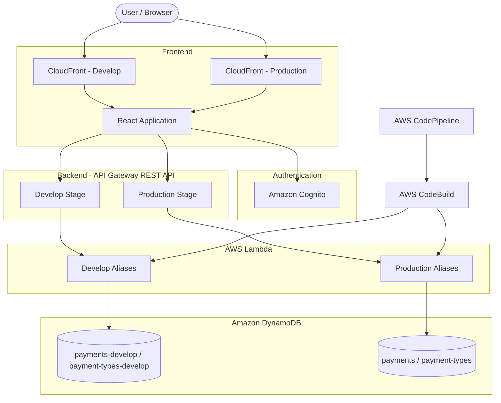

# Household Expenses Manager

A serverless web application for managing household expenses. The application uses React for the frontend and AWS services for authentication, API processing, data storage, and automated deployments.

## Table of Contents

- [Overview](#overview)
- [Architecture](#architecture)
- [Request Flow](#request-flow)
- [AWS Services](#aws-services)
- [Environments](#environments)
- [CI/CD Pipeline](#cicd-pipeline)
- [Local Development](#local-development)
- [Configuration and Secrets](#configuration-and-secrets)
- [Deployment Process](#deployment-process)
- [Security and IAM](#security-and-iam)

## Overview

The application is built using a serverless architecture. The frontend communicates with an API Gateway REST API, which invokes AWS Lambda functions. Lambda functions process requests and access data stored in DynamoDB.

Amazon Cognito provides user authentication. AWS CodePipeline and CodeBuild automate testing, building, and deployment.

The project supports separate development and production environments, with independent DynamoDB tables and environment-specific Lambda aliases.

## Architecture



The diagram shows the logical architecture. Frontend hosting and deployment details depend on the configured CloudFront origins and pipeline actions.

## Request Flow

1. The user opens the React application delivered through CloudFront.
2. The frontend authenticates the user through Amazon Cognito.
3. The frontend sends HTTP requests to the appropriate API Gateway stage.
4. API Gateway invokes the corresponding Lambda function through the environment-specific alias.
5. The Lambda function reads or writes data in the appropriate DynamoDB tables.
6. The API response is returned to the frontend.

## AWS Services

| Service | Responsibility |
| --- | --- |
| Amazon CloudFront | Delivers the frontend through separate development and production distributions. |
| Amazon API Gateway | Exposes REST API endpoints and routes requests to Lambda functions. |
| AWS Lambda | Executes backend business logic using Node.js 24 and ES modules. |
| Amazon DynamoDB | Stores payments and payment types. |
| Amazon Cognito | Handles user authentication and token verification. |
| AWS Systems Manager Parameter Store | Stores environment-specific configuration and secrets. |
| AWS CodePipeline | Orchestrates the CI/CD workflow. |
| AWS CodeBuild | Installs dependencies, runs build commands, packages Lambdas, and deploys application components. |
| Amazon CloudWatch | Stores Lambda and build logs for troubleshooting. |
| Amazon SNS | Supports notification-related functionality, including reminder processing. |
| AWS IAM | Controls access to AWS services and resources. |

## Environments

The application uses two environments: development and production.

### Development

The development environment is intended for testing new features, validating changes, and identifying defects before production deployment.

It uses separate DynamoDB tables and environment-specific Lambda aliases.

| Component | Development configuration |
| --- | --- |
| API Gateway | Develop stage |
| Lambda | Development aliases |
| DynamoDB payments table | `payments-develop` |
| DynamoDB payment types table | `payment-types-develop` |
| CloudFront | Development distribution |
| Purpose | Feature development and testing |

### Production

The production environment serves the application to its intended users. Changes should be deployed only after successful validation in development.

| Component | Production configuration |
| --- | --- |
| API Gateway | Production stage |
| Lambda | Production aliases |
| DynamoDB payments table | `payments` |
| DynamoDB payment types table | `payment-types` |
| CloudFront | Production distribution |
| Purpose | Live application usage |

### Environment Isolation

Development and production resources should remain logically separated to prevent test operations from affecting production data.

The deployment configuration should explicitly identify the target environment, AWS resource names, Lambda aliases, API Gateway stage, and frontend distribution.

Production deployments should use production-specific configuration and should never rely on development resources as fallbacks.

## CI/CD Pipeline

The application uses AWS CodePipeline and AWS CodeBuild to automate the build and deployment process.

The pipeline is responsible for retrieving source code, installing dependencies, running validation commands, building the frontend, packaging backend functions, and deploying the required resources.

### Pipeline Stages

1. **Source:** Retrieves the application source code from the configured repository.
2. **Install:** Installs frontend and backend dependencies.
3. **Validation:** Runs available linting, unit tests, and other automated checks.
4. **Build:** Compiles the React application and prepares Lambda deployment packages.
5. **Development Deployment:** Deploys the application to development resources.
6. **Production Deployment:** Deploys validated changes to production resources, subject to the configured approval process.

The actual stages and their order depend on the CodePipeline configuration.

### Build Process

AWS CodeBuild executes the commands defined in the build configuration, typically in a `buildspec.yml` file.

The build process may include:

- Installing Node.js dependencies.
- Running frontend build commands.
- Running backend tests.
- Packaging Lambda functions.
- Publishing build artifacts.
- Updating Lambda function code and aliases.
- Deploying frontend assets.
- Invalidating the relevant CloudFront cache.

The build configuration must provide the correct AWS region, resource identifiers, deployment permissions, and environment-specific settings.

### Deployment Safety

Production deployment should be protected by automated checks and, where appropriate, a manual approval stage.

A failed validation or deployment step should stop the pipeline rather than continue with an incomplete release.

Deployment logs should be retained in CloudWatch or the configured build-log destination to support troubleshooting.

## Local Development

Local development requires Node.js 24, npm, Git, and access to the relevant project repository.

AWS CLI credentials are required only for workflows that interact with AWS resources.

### Prerequisites

Install the following tools:

- Node.js 24.
- npm, included with Node.js.
- Git.
- AWS CLI, if AWS resource access is required.

Verify the installed versions:

```bash
node --version
npm --version
git --version
aws --version
```

### Clone the Repository

```bash
git clone <repository-url>
cd <repository-directory>
```

Replace the placeholders with the actual repository URL and directory name.

### Install Dependencies

For a project using npm, install dependencies in the frontend and backend directories as applicable.

```bash
npm install
```

If the frontend and backend use separate `package.json` files, run the installation command in each relevant directory.

Use `npm ci` in CI environments when a committed `package-lock.json` is available and reproducible dependency installation is required.

### Configure Local Environment Variables

Create a local environment configuration file using the variable names expected by the application.

For example, a React frontend might require:

```dotenv
VITE_API_URL=
VITE_COGNITO_USER_POOL_ID=
VITE_COGNITO_CLIENT_ID=
```

These names are illustrative. The actual variable names depend on the frontend build tool and application implementation.

Frontend variables embedded during the build must not contain AWS credentials, private keys, or other confidential values.

### Run the Application

Use the scripts defined in the relevant `package.json` files.

For a frontend that provides a Vite development script:

```bash
npm run dev
```

For a frontend that provides a standard build script:

```bash
npm run build
```

The available commands depend on the project's scripts. Consult the relevant `package.json` before running them.

### Local AWS Access

If local development requires access to AWS, configure credentials using an approved AWS CLI profile or another supported identity mechanism.

```bash
aws configure --profile household-expenses-develop
```

Verify the active identity:

```bash
aws sts get-caller-identity --profile household-expenses-develop
```

Use an appropriately restricted development identity. Do not use production credentials for routine local development.

## Configuration and Secrets

The application uses environment-specific configuration to connect frontend and backend components to the correct AWS resources.

AWS Systems Manager Parameter Store is used to store configuration values and secrets where required.

### Configuration Categories

Configuration may include:

- AWS region.
- API Gateway endpoint URLs.
- Cognito user pool identifiers.
- Cognito application client identifiers.
- DynamoDB table names.
- Lambda deployment settings.
- CloudFront distribution identifiers.
- SNS topic identifiers.
- Environment-specific feature settings.

The exact parameters depend on the application code and deployment configuration.

### Parameter Store

Use separate parameter paths for development and production.

An illustrative naming convention is:

```text
/household-expenses/develop/api-url
/household-expenses/develop/payments-table
/household-expenses/develop/payment-types-table

/household-expenses/production/api-url
/household-expenses/production/payments-table
/household-expenses/production/payment-types-table
```

These paths are examples and should be aligned with the actual parameter names used by the application.

For sensitive values, use `SecureString` parameters and an appropriate AWS KMS encryption configuration.

Non-sensitive configuration can use `String` parameters.

### Accessing Parameters

Applications and deployment jobs should retrieve only the parameters required for their responsibilities.

For example, an authorized operator can retrieve a non-sensitive parameter using:

```bash
aws ssm get-parameter \
  --name "/household-expenses/develop/api-url" \
  --profile household-expenses-develop \
  --region <aws-region>
```

For a `SecureString` parameter, use `--with-decryption` only when the caller is authorized to access the decrypted value.

```bash
aws ssm get-parameter \
  --name "/household-expenses/develop/example-secret" \
  --with-decryption \
  --profile household-expenses-develop \
  --region <aws-region>
```

Replace the example parameter names and AWS region with the values configured for the project.

### Secrets Management

Follow these rules when managing secrets:

- Never commit credentials, access keys, tokens, or private keys to source control.
- Do not include secrets in frontend environment variables.
- Restrict access to sensitive parameters through IAM policies.
- Use KMS permissions only where required.
- Avoid printing secret values in build logs.
- Keep development and production secrets separate.
- Rotate credentials when required by the applicable security policy.

## Deployment Process

Deployments should follow a controlled process that keeps development and production resources isolated.

### Development Deployment

1. Commit the changes to the configured source repository.
2. Trigger the development pipeline.
3. Install dependencies and run the configured validation checks.
4. Build the React application and package Lambda functions.
5. Deploy the backend to the development Lambda functions and update the relevant aliases.
6. Deploy frontend assets to the configured development hosting origin.
7. Invalidate the development CloudFront cache if required.
8. Verify authentication, API requests, and DynamoDB operations.

### Production Deployment

1. Confirm that the changes have passed development validation.
2. Verify that all required automated checks have passed.
3. Review the production configuration and deployment artifacts.
4. Obtain the required approval, if configured.
5. Deploy the backend and update production Lambda aliases.
6. Deploy frontend assets to the production hosting origin.
7. Invalidate the production CloudFront cache if required.
8. Perform post-deployment verification.
9. Monitor application logs and error metrics.

The exact deployment order must account for API compatibility, frontend/backend dependencies, and the project's rollback strategy.

### Post-Deployment Verification

After each deployment, verify:

- The frontend loads successfully.
- Cognito authentication works as expected.
- API Gateway endpoints return the expected responses.
- Lambda functions execute without unexpected errors.
- The correct DynamoDB tables are accessed.
- Notifications work where applicable.
- CloudFront serves the current frontend assets.
- CloudWatch contains no unexpected error patterns.

### Rollback

If a deployment introduces a critical issue, restore the last known good application version using the project's supported rollback procedure.

Potential rollback actions include:

- Repointing a Lambda alias to a previously published Lambda version.
- Redeploying a previous frontend build.
- Restoring a previous API or infrastructure configuration.
- Reverting a source change and running the deployment pipeline again.

Lambda alias rollback does not automatically restore DynamoDB data. Database changes and data migrations require a separate recovery strategy.

Before performing a rollback, assess whether the release introduced schema changes or data modifications that affect compatibility with the previous application version.

## Security and IAM

Security is based on least-privilege access, environment separation, secure authentication, and controlled deployment permissions.

### IAM Principles

- Grant only the permissions required for a specific task.
- Separate runtime permissions from deployment permissions.
- Restrict production deployment access.
- Avoid long-lived IAM user access keys when role-based access is available.
- Use separate roles for CodeBuild, Lambda execution, and other services where appropriate.
- Review IAM policies regularly.
- Avoid wildcard resource permissions when resource-level restrictions are supported.

### Lambda Execution Roles

Each Lambda function should use an execution role with only the permissions required by its business logic.

Depending on the function, these permissions may include:

- Reading or writing specific DynamoDB tables.
- Reading selected Parameter Store parameters.
- Decrypting authorized SecureString parameters when required.
- Publishing messages to designated SNS topics.
- Writing application logs to CloudWatch.

Development Lambda functions should not have unnecessary permissions to access production data.

### CodeBuild and CodePipeline Permissions

The CI/CD pipeline requires permissions to retrieve source code, execute builds, publish artifacts, and deploy the configured application resources.

Deployment roles should be restricted to the resources and actions required by the pipeline.

Production deployment permissions should be separated from ordinary development permissions wherever practical.

Build processes must not expose credentials or sensitive parameter values in logs or artifacts.

### Authentication and API Authorization

Amazon Cognito provides the application's authentication mechanism.

The backend should validate the relevant Cognito-issued tokens and enforce authorization for protected operations.

Authentication alone does not establish that a user is authorized to access every household payment or resource.

Where the application supports multiple users or households, backend authorization must verify access to the requested records. Clients must not be trusted to enforce data ownership by themselves.

API Gateway should be configured with the appropriate authorization mechanism for protected endpoints.

### DynamoDB Access

DynamoDB permissions should be restricted to the tables and operations required by each Lambda function.

For example, a function that reads payment types should not automatically receive unrestricted access to every table in the account.

Production data should be protected from accidental development writes. Backup, point-in-time recovery, retention, and recovery procedures should be configured according to the application's data protection requirements.

### Logging and Monitoring

Amazon CloudWatch provides logs for Lambda execution and build processes.

Logs should support troubleshooting without unnecessarily exposing personal information, authentication tokens, credentials, or financial details.

Monitor relevant operational indicators, including:

- Lambda errors and timeouts.
- API Gateway error responses and latency.
- DynamoDB throttling and request failures.
- Failed CI/CD executions.
- Unexpected authentication or authorization failures.

Configure alarms and notifications according to the application's operational requirements.

### Security Checklist

- [ ] Development and production resources are separated.
- [ ] IAM policies follow least-privilege principles.
- [ ] Lambda execution roles are restricted to required resources.
- [ ] Production deployment permissions are controlled.
- [ ] Secrets are stored securely and excluded from source control.
- [ ] Cognito tokens are validated by the backend.
- [ ] Authorization checks protect individual records and household data.
- [ ] CloudWatch logs do not expose sensitive information.
- [ ] DynamoDB backup and recovery requirements are addressed.
- [ ] Deployment and rollback procedures are documented.
